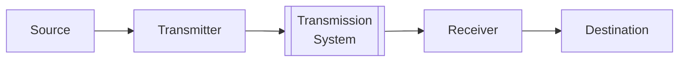
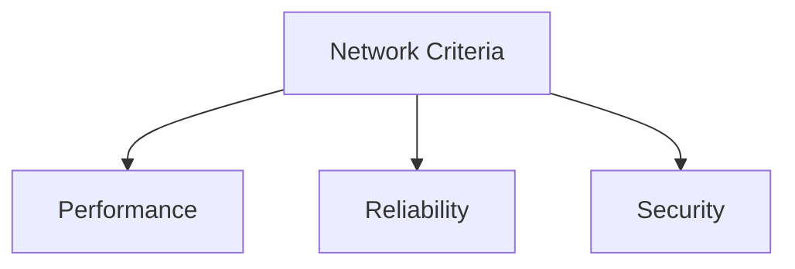
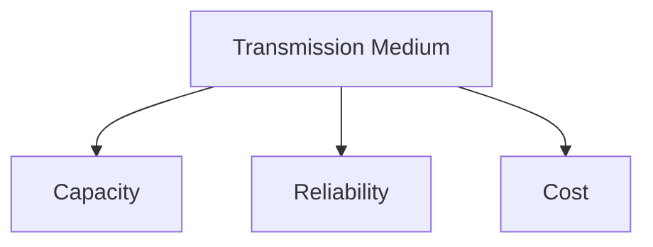
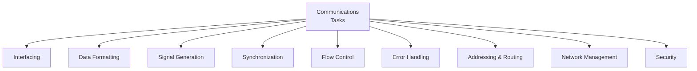
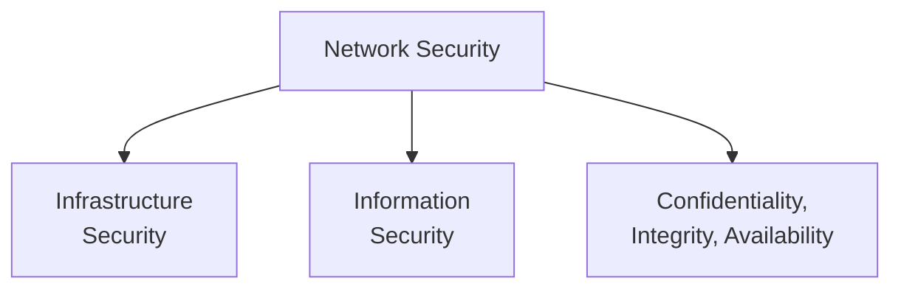

> [!abstract] TL;DR Every network conversation boils down to **five parts**: a source, a transmitter, a medium, a receiver, and a destination — all obeying a **protocol** (the shared rulebook). Everything else in this lecture (criteria, tasks, security) is just _"what has to go right"_ for that conversation to actually work.

---

## 1. What is Data Communication?

Break the term into its two halves — it's more literal than it sounds:

- **Tele-communication** → communication **at a distance**.
- **Data** → information in whatever form the sender and receiver _agree_ to use.

> [!important]+ 📖 DEFINITION — Data Communication
> 
> ## ==Data communication is the exchange of data between two devices via some transmission medium (a wire, radio wave, fiber, etc.)==

> [!important]+ 📖 DEFINITION — The Fundamental Problem of Communication
> 
> ## ==Reproduce, at the receiving end, exactly or approximately the message that was sent — reliably and efficiently, despite noise, distance, and interference.==

**Memory hook:** 📡 _Data comm = "shouting across a canyon and making sure the echo that comes back still makes sense."_

---

## 2. The Simple Communication Model

Every communication system — from two tin cans on a string to a 5G network — reduces to **five components**.

|Component|Role|Everyday analogy|
|---|---|---|
|**Source**|Generates the data to be sent|You, thinking of a sentence to say|
|**Transmitter**|Converts data into a _transmittable signal_|Your mouth turning thoughts into sound waves|
|**Transmission System**|Carries the signal across distance|The air between you and your friend|
|**Receiver**|Converts the received signal back into data|Your friend's ear|
|**Destination**|Consumes / processes the incoming data|Your friend's brain, understanding you|

> [!important]+ 📖 DEFINITION — Protocol
> 
> ## ==A protocol is an established set of rules that determine how data is transmitted between different devices in a network.==
> 
> Without a shared protocol, the receiver gets signals but no meaning — like someone speaking to you in a language you've never heard.

**Message** — the actual data/content being exchanged (the other piece that ties the model together, alongside Protocol).

**Memory hook:** 🗣️ **S**ource → **T**ransmitter → **T**ransmission system → **R**eceiver → **D**estination = **"Some Trains Travel Really Distant"**

---

## 3. Network Criteria — "What makes a network good?"

Three pillars judge the quality of any network:

- **Performance**
    - **Throughput** — the rate data is _successfully_ delivered (measured in **bps** — bits per second).
    - **Delay** — time for a packet to travel from source → destination.
- **Reliability**
    - Data received must be **identical** to data sent.
    - Measured by _how often_ failures happen, and _how fast_ the link recovers from one.
- **Security**
    - Protecting data from **unauthorized access**.

---

## 4. Transmission Medium — the "road" data travels on

> [!important]+ 📖 DEFINITION — Transmission Medium
> 
> ## ==The transmission line is the most basic building block of any communications system.==
> 
> Despite falling costs elsewhere, it's historically the **most expensive component** of a communications setup. That's why techniques like **multiplexing** and **compression** exist — to squeeze more value out of an expensive resource.

Three factors decide whether a medium is _good_:

- **Capacity** — more is better.
- **Reliability** — needs to clear a _minimum acceptable_ bar.
- **Cost** — less is better.

**Memory hook:** 💰 _"I want a medium that's Cheap, Capable, and Consistent — the 3 C's disguised as Capacity/Reliability/Cost."_

---

## 5. Communications Tasks — everything a system must handle

Once you have a medium, a bunch of _jobs_ need doing to actually move data across it. This is the backbone of the lecture — think of it as a checklist every communication system silently runs through.

|Task|What it means|
|---|---|
|**Interfacing**|Establishing the connection between a device and the transmission system so it can actually join the network|
|**Data Formatting**|Making sure data conforms to the expected format for transmission (encoding, framing)|
|**Message Exchange Management**|Overseeing the sending, receiving, and processing of messages between network entities|
|**Signal Generation**|Converting digital/analog data into electrical, optical, or RF signals that can actually travel the medium|
|**Synchronization**|Coordinating transmitter and receiver _timing_ — so both sides agree on when a signal starts and ends|
|**Error Handling**|Detecting and correcting errors introduced during transmission|
|**Flow Control**|Making sure the sender doesn't overwhelm the receiver — prevents data loss, buffer overflow, wasted resources|
|**Addressing & Routing**|Giving devices unique addresses and guiding data efficiently from source to destination|
|**Network Management**|The activities/tools/protocols used to plan, monitor, optimize, and maintain the network|
|**Security**|Safeguarding integrity, confidentiality, availability, and authenticity of data/resources|
|**Transmission System Utilization**|Using the transmission system and its resources efficiently, at as close to full capacity as possible|

**Memory hook:** 🧩 Picture a mail courier service:

- **Interfacing** = the courier picks up the package from your door.
- **Data Formatting** = packing it in a standard-size box.
- **Signal Generation** = putting it on the truck.
- **Synchronization** = truck and warehouse agree on delivery windows.
- **Flow Control** = warehouse doesn't get 1000 packages at once and collapse.
- **Error Handling** = damaged box gets caught and re-sent.
- **Addressing & Routing** = the address label + the delivery route.
- **Network Management + Security** = the logistics company's control tower, watching over everything.

---

## 6. Network Security — the CIA of networking

Security splits into two flavors, both protecting the **same three properties**:

> [!important]+ 📖 DEFINITION — Confidentiality
> 
> ## ==Only authorized parties can read the data.==

> [!important]+ 📖 DEFINITION — Integrity
> 
> ## ==Data isn't tampered with in transit.==

> [!important]+ 📖 DEFINITION — Availability
> 
> ## ==The network/data is accessible when it's supposed to be.==

**Memory hook:** 🔒 **C.I.A.** — same acronym as the agency, and just as good at keeping secrets, staying accurate, and staying "always on duty."

---

## 🧠 Quick Recall Table

| Concept              | One-line memory trigger                                                                    |
| -------------------- | ------------------------------------------------------------------------------------------ |
| 5-part comm model    | "Some Trains Travel Really Distant" (Source→Transmitter→Transmission→Receiver→Destination) |
| Network criteria     | Performance, Reliability, Security — **"How fast, how trustworthy, how safe?"**            |
| Medium factors       | Capacity ↑, Reliability ↑ (to a minimum), Cost ↓                                           |
| Communications tasks | The mail-courier pipeline: pickup → pack → send → pace → fix errors → deliver → oversee    |
| Security triad       | C.I.A. — Confidentiality, Integrity, Availability                                          |

---

## 🔀 Key Differences (easy to mix up)

> [!tip] Throughput vs. Latency
> 
> - **Throughput / Bandwidth** — bits transferred per second.
> - **Latency / Delay** — time between sending a bit and its _earliest possible_ arrival.
> 
> Think of it as a highway 🚗: **throughput = number of lanes**, **latency = how long one car takes to drive the length of the road**.

> [!tip] Network Infrastructure Security vs. Information Security
> 
> - **Network Infrastructure Security** — protecting the physical/logical network (routers, links, devices) itself.
> - **Information Security** — protecting the _data_ that travels across and lives on that network.
> 
> Both are still judged against the same three requirements: **Confidentiality, Integrity, Availability**.

> [!tip] Reliability (Network Criteria) vs. Reliability (Transmission Medium)
> 
> - As a **network criterion** — data received must match data sent; measured by failure frequency and recovery time.
> - As a **medium factor** — the medium must clear a _minimum acceptable_ reliability bar before it's even usable.
> 
> Same word, two contexts: one measures the _outcome_, the other is a _requirement to qualify_ the medium in the first place.